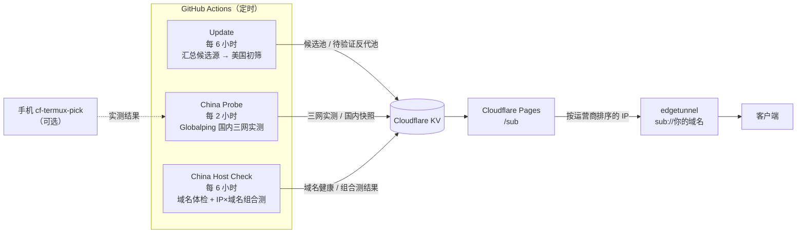

# Preferred Sub Generator

[](https://github.com/LeilaoMi/preferred-sub-generator/actions/workflows/ci.yml)
[](LICENSE)

给 cmliu 版 [edgetunnel](https://github.com/cmliu/edgetunnel) 用的 **国内实测** Cloudflare 优选 IP 订阅器。
部署在 Cloudflare Pages，由 GitHub Actions 定时驱动，Fork 后填两个 Secret 即可运行，日常维护用手机浏览器就能完成。

它只做一件事：**用中国大陆电信、联通、移动三张网真实测过，挑出连得上你节点的 Cloudflare 入口 IP，按稳定的顺序交给 edgetunnel。**
UUID、域名、路径这些节点参数由 edgetunnel 自己保管，本项目在 `sub://` 模式下既不需要、也拿不到。

> [!NOTE]
> 本项目只优化「入口」（你连到 Cloudflare 的那一跳），不修复坏节点，也无法控制 Cloudflare 访问目标网站时的出口 IP。

---

## 目录

- [一图看懂](#一图看懂)
- [特性](#特性)
- [快速开始](#快速开始)
- [接入 edgetunnel](#接入-edgetunnel)
- [节点名怎么读](#节点名怎么读)
- [配置](#配置)
- [排序规则](#排序规则)
- [美国反代池](#美国反代池)
- [手机实测](#手机实测)
- [接口与状态页](#接口与状态页)
- [定时任务](#定时任务)
- [安全](#安全)
- [已知局限](#已知局限)
- [常见问题](#常见问题)
- [本地开发](#本地开发)
- [文档](#文档)
- [免责声明](#免责声明)
- [致敬](#致敬)

## 一图看懂



- **Update**：汇总 Cloudflare 官方段与社区源，在 GitHub Actions（美国）上做初筛，结果写入 KV 作为候选池；社区反代 IP 进入「待国内验证」池。
- **China Probe**：借 [Globalping](https://globalping.io) 的中国大陆电信 / 联通 / 移动探针，对候选池做 HTTPS 实测，记录延迟和国内实际落地机房，并合并手机实测。
- **China Host Check**：从三网访问你的节点域名，识别 DNS 污染、SNI 阻断；再拿排名靠前的 IP 配你的域名做组合测（能识别 `1034`、连接重置）。
- **Pages `/sub`**：按运营商排序输出；生成失败时用最后一次国内验证通过的快照兜底，对 edgetunnel 永远返回 200。

## 特性

| | 常见优选器 | 本项目 |
|---|---|---|
| 在哪测 | 境外服务器或浏览器 | Globalping **国内三网探针**，可叠加你自己手机的实测 |
| 测什么 | TCP 延迟 | HTTPS `/cdn-cgi/trace`：延迟 + 国内落地机房；另有 **IP × 你的域名** 组合测 |
| 分运营商 | 否 | 电信 / 联通 / 移动各一份排名，可各用一个订阅地址 |
| 顺序 | 常随机 | 固定顺序，带衰减、分档与失败惩罚，结果不乱跳 |
| 实测失败时 | 空结果或随机 | 用最近一次国内验证通过的名单兜底 |
| 域名被墙 | 不知道 | 定时三网体检，`/status` 可见，可推送告警 |
| 落地机房 | 不控制 | 可用 `SUB_LANDING` 只要指定地区 / 机房的入口（例如美国出口） |

另外支持：直接输出 Clash / Mihomo、Stash、sing-box、Surge、Loon、Shadowrocket、v2rayNG 订阅；美国反代池；手机实测回传；社区实测池；Telegram / Bark / Webhook 告警。

## 快速开始

1. **Fork** 本仓库，打开 Fork 后仓库的 **Actions** 页，点击「I understand my workflows, go ahead and enable them」（GitHub 默认关闭 Fork 的定时任务）。
2. 进入 **Settings → Secrets and variables → Actions → Secrets**，新建：

   | Secret | 必填 | 说明 |
   |---|---|---|
   | `CLOUDFLARE_ACCOUNT_ID` | 是 | Cloudflare 控制台右侧栏的账户 ID |
   | `CLOUDFLARE_API_TOKEN` | 是 | 「我的个人资料 → API 令牌」创建，权限：**Cloudflare Pages：编辑**、**Workers KV 存储：编辑**；可加 **D1：编辑**（不加也能跑，测速回传改存 KV） |
   | `GLOBALPING_TOKEN` | 建议 | [globalping.io](https://globalping.io) 免费注册获取，国内实测额度更高 |

3. 在 Actions 页依次手动运行：**Deploy to Cloudflare Pages** → **Update Preferred Subscription** → **China Probe (Globalping)**。

KV 命名空间、D1 数据库、Pages 项目都由 `scripts/cf-bootstrap.js` 自动查找或创建，不用改任何文件。部署地址在 Cloudflare 控制台的 Pages 项目页可以看到（默认项目名 `preferred-sub-generator`，可用 Actions 变量 `PAGES_PROJECT` 修改）。之后每次 push 到 `main` 都会自动重新部署。

> [!TIP]
> 想让结果更贴近你的线路，再去 **Variables** 里填 `CHECK_HOSTS`、`VLESS_HOST` 和 `SUB_DEFAULT_ISP`，见 [配置](#配置)。

## 接入 edgetunnel

在 edgetunnel 面板的 **自定义优选订阅** 里填：

```text
sub://你的部署域名
```

edgetunnel 会自行请求 `/sub?host=example.com&uuid=全0`（UA 含 `edgetunnel`）。本项目识别这种请求后返回 base64 编码的占位订阅：最多 30 个 IP，节点参数是占位值，edgetunnel 只取其中的 IP 和端口，换上自己的节点参数。这类请求永远返回 200 并在边缘缓存 5 分钟，因为 edgetunnel 遇到非 200 会塞进一个 `127.0.0.1` 的假节点。

### 分运营商订阅

edgetunnel 会丢弃 `sub://` 后面的 `?` 参数，但保留子域名，所以按子域名区分运营商：

| 子域名 | 运营商 |
|---|---|
| `ct.你的域名` 或 `dx.你的域名` | 电信 |
| `cu.你的域名` 或 `lt.你的域名` | 联通 |
| `cm.你的域名` 或 `yd.你的域名` | 移动 |

在 Pages 项目里把这些子域名绑为自定义域名，edgetunnel 里填 `sub://cu.你的域名` 即按联通的国内实测排序。没绑子域名时，用 `SUB_DEFAULT_ISP` 指定默认运营商。

### 容易踩的坑

- edgetunnel 面板的 **「随机 IP」开关要关掉**。开着时它不会读取你填的优选订阅。
- `sub://` 后面不要加任何 `?` 参数，加了也会被丢弃。面板的「验证优选 API」可以预览返回的 IP。
- 客户端请使用 **自动选择 / url-test** 组，不要固定单个节点。国内到 Cloudflare 的单个 IP 时好时坏是常态，移动网络上更明显。

## 节点名怎么读

节点名里的地点 **只来自国内实测**（Globalping 的 HTTPS 实测 / 组合测，或手机实测）。美国初筛看到的机房不会出现在名字里，因为同一个 IP 从美国和从国内连，落地机房往往不同。

| 节点名示例 | 含义 |
|---|---|
| `🇯🇵 日本东京 NRT 95ms 实测 #1` | 国内实测落地东京，加权延迟 95ms |
| `🇨🇳 联通 119ms 实测 #2` | 联通网实测通过，但没拿到落地机房，不猜地点 |
| `🌐 未实测 #3` | 没有带延迟的国内实测（手动置顶、补位或兜底节点） |
| `[IPv6] 🌐 未实测 #4` | IPv6 节点（仅 `?ip6=1` 时追加，未实测） |

Clash / Stash 输出里的地区分组按同一规则归类。

## 配置

不填任何变量也能运行，填了结果更准。配置分两处，**不要填错地方**：

- **GitHub Actions**（仓库 Settings → Secrets and variables → Actions）：影响定时任务怎么测、测什么。
- **Cloudflare Pages 环境变量**（Pages 项目 → 设置 → 变量和机密）：影响 `/sub` 等接口怎么输出、怎么鉴权。

### GitHub Actions：常用变量（Variables）

| 变量 | 作用 | 示例 |
|---|---|---|
| `SUB_DEFAULT_ISP` | 订阅默认按哪个运营商的实测排序；China Probe 会把它写进 KV，Pages 端自动读取 | `CU` / `CT` / `CM` |
| `CHECK_HOSTS` | 你 edgetunnel 实际用的域名，逗号分隔（最多 20 个）。开启域名体检和 IP × 域名组合测 | `a.example.com,b.example.com` |
| `VLESS_HOST` | 美国初筛和国内 HTTPS 实测用的 SNI，填你的主节点域名。不填时初筛用 `speed.cloudflare.com` | `a.example.com` |
| `SUB_LANDING` | 只要国内入口落在这些 Cloudflare 机房的节点。可写 `US` / `ASIA` / `EU` 或三字码 | `US`、`LAX,SJC,SEA` |

> `SUB_LANDING` 的意义：edgetunnel 访问非 Cloudflare 托管站点时，出口就在入口落地的机房。想要美国出口（例如访问 AI 服务），填 `US`。

<details>
<summary><b>GitHub Actions：全部 Secrets 与 Variables</b></summary>

**Secrets**

| 名称 | 作用 |
|---|---|
| `CLOUDFLARE_API_TOKEN` | Cloudflare API 令牌（旧名 `CLOUDFLARE_API_TOKEN_2` 仍兼容，二者填一个即可） |
| `CLOUDFLARE_ACCOUNT_ID` | Cloudflare 账户 ID |
| `CLOUDFLARE_NAMESPACE_ID` | 可选。指定已有的 KV 命名空间；不填时自动查找或创建名为 `preferred-sub-generator-kv` 的命名空间 |
| `GLOBALPING_TOKEN` | 可选。提高 Globalping 额度 |
| `TG_BOT_TOKEN` + `TG_CHAT_ID` | 可选。Telegram 告警 |
| `BARK_URL` | 可选。iOS Bark 告警，如 `https://api.day.app/你的key` |
| `UPDATE_WEBHOOK_URL` | 可选。告警 Webhook，原样 POST JSON |

**Variables**

| 名称 | 用于 | 默认 | 作用 |
|---|---|---|---|
| `PAGES_PROJECT` | Deploy、Host Check | `preferred-sub-generator` | Pages 项目名 |
| `VLESS_SNI` | Update、Probe、Host Check | 空 | 与 `VLESS_HOST` 二选一，作为探测 SNI 的备选 |
| `VLESS_SECURITY` | Update | `tls` | 设为非 `tls` 时初筛改测非 TLS 端口 |
| `SUB_DOMAIN` | Host Check | 空 | 未配置节点域名时，体检这个域名（否则体检 `<PAGES_PROJECT>.pages.dev`） |
| `CN_PROBE_BUDGET` | Probe | 有 token 120，无 token 60 | 每轮国内实测的 IP 数；会按 Globalping 剩余额度自动下调 |
| `CN_PROBE_MODE` | Update、Probe、Host Check | `http` | `http`：HTTPS 请求 `/cdn-cgi/trace`，拿到 trace 才算通并记录落地机房；`ping`：退回 TCP 握手（测不到 SNI 阻断和机房，此时 `SUB_LANDING` 不生效） |
| `CN_COMBO_TOP` | Host Check | `10` | 每轮做 IP × 域名组合测的 IP 数，`0` 关闭 |
| `SUB_ROTATE_HOSTS` | Host Check | 空 | `1`：直接订阅时，节点 host/SNI 轮换为该运营商未被墙的 `CHECK_HOSTS`（域名须绑在同一个 edgetunnel 上；对 `sub://` 无效） |
| `ALLOW_RELAY` | Update | 放行 | `0`：远程源里的 IPv4 只保留 Cloudflare 官方段，不收社区反代 IP，也不建美国反代池 |
| `CN_PENDING_MAX` | Update | `500` | 待国内验证的反代池上限（美国反代排前面） |
| `EDGE_BLACKLIST` | Update | 空 | 额外拉黑的网段，逗号分隔 CIDR |
| `PUBLIC_CN_VERIFIED` | Probe | 空 | `1`：公开 `/cn-verified`（只含 IP、端口、延迟、成功率、机房） |
| `COMMUNITY_POOL_URL` | Probe | 空 | 别人公开的 `/cn-verified` 地址，用于冷启动；永远排在自己的数据之后 |
| `PHONE_RESULTS_URL` | Probe | `https://raw.githubusercontent.com/<你的用户名>/cf-termux-pick/main/best-ips.json` | 手机实测结果地址；地址不存在时自动跳过 |
| `ALERT_MIN_AVAILABLE` | Update、Host Check | `10` | 可用节点 / 某网已验证节点低于该值时告警 |
| `ALERT_FALLBACK_THRESHOLD` | Update | `3` | 连续多少次刷新退回上次结果时告警 |
| `ALERT_DROP_RATIO` | Update | `0.3` | 可用数较上次下降超过该比例时告警 |
| `ALERT_REPEAT_HOURS` | Update | `24` | 同一告警的重复提醒间隔（小时） |
| `UPDATE_WEBHOOK_ALWAYS` | Update | 空 | `1`：每次刷新都推送，而不只在状态变化时 |

</details>

### Cloudflare Pages 环境变量

这些变量只在 Pages 项目里配置才生效，填在 GitHub Actions 里无效。改完需要重新部署（push 一次或手动运行 Deploy）。

| 变量 | 默认 | 作用 |
|---|---|---|
| `SUB_PUBLIC` | 公开 | 设为 `0` 后，`/sub`、`/best`、`/versions` 必须带只读 token |
| `SUB_READ_TOKEN` | 空 | 只读 token（`?t=` 或 `Authorization: Bearer`），用于订阅类接口 |
| `SUB_TOKEN` | 空 | 管理 token，用于 `/health/full`、`/api/template`、`/api/ip-feedback` 等；也可以用 `/setup.html` 存进 KV |
| `SETUP_CODE` | 空 | 开启网页设置管理 token 所需的设置码（至少 8 位） |
| `SUB_RELAY_BONUS_MS` | `60` | 反代 IP（`relay-*`、`cmliu*` 源）国内实测通过时的排序加分（ms），`0` 关闭 |
| `SUB_LANDING` | 跟随 Actions | 落地白名单；不填时使用 China Probe 写入 KV 的那份 |
| `SUB_DEFAULT_ISP` | 跟随 Actions | 默认运营商；不填时使用 China Probe 写入 KV 的那份 |
| `SUB_VERIFIED_DAYS` | `3` | 只采信最近几天的国内实测 |
| `SUB_MIN_NODES` | `10` | 实测通过 + 手动置顶不足该数时，用过审池或快照补齐 |

<details>
<summary><b>Pages 环境变量：其余可选项</b></summary>

| 变量 | 作用 |
|---|---|
| `VLESS_UUID` / `VLESS_SNI` / `VLESS_HOST` / `VLESS_PATH` / `VLESS_PORT` / `VLESS_TYPE` / `VLESS_SECURITY` | 服务端节点模板。只对带只读 token 的直接订阅请求生效，匿名请求永远不会用到 |
| `SUB_READ_TOKEN_NEXT` / `SUB_TOKEN_NEXT` | token 轮换期间的新 token |
| `SUB_TOKEN_ROTATE_DAYS` | 只读 token 按天数周期自动派生轮换，默认关闭 |
| `SUB_ALLOWED_IPS` | token 鉴权接口的来源 IP 白名单，逗号分隔 |
| `ALLOW_QUERY_TOKEN` | `1`：管理接口额外接受 `?token=`（默认只接受 `Authorization: Bearer`） |
| `IP_HASH_SALT` | 测速反馈中访客 IP 哈希的盐；不填时使用 `SUB_TOKEN` |
| `SUB_RTT_DROP_MS` | 实测延迟超过该值不算通过，默认 `1000` |
| `SUB_PREFERRED_PORTS` | 覆盖端口优先顺序，如 `443,8443,2053` |
| `SUB_ROTATE_HOSTS` / `CHECK_HOSTS` | 与 Actions 同名变量含义相同，Pages 端优先 |
| `PUBLIC_CN_VERIFIED` | `1`：公开 `/cn-verified`（也可由 Actions 同名变量开启） |

</details>

### 用文件代替变量：`config/instance.json`

不方便打开设置页时，可以直接在 GitHub 网页编辑 [`config/instance.json`](config/instance.json)：

```json
{
  "你的用户名/preferred-sub-generator": {
    "CHECK_HOSTS": "a.example.com,b.example.com",
    "SUB_DEFAULT_ISP": "CU",
    "VLESS_HOST": "a.example.com",
    "SUB_LANDING": "US"
  }
}
```

- 只有键名等于 **当前仓库全名** 时才生效，生效时覆盖同名 Actions 变量。仓库里现有的条目属于上游仓库，Fork 不会继承，需要按自己的仓库名新增一项。
- 只作用于 GitHub Actions，Pages 端读不到。允许的键：`CHECK_HOSTS`、`SUB_DEFAULT_ISP`、`VLESS_HOST`、`VLESS_SNI`、`SUB_DOMAIN`、`CN_COMBO_TOP`、`SUB_ROTATE_HOSTS`、`PUBLIC_CN_VERIFIED`、`COMMUNITY_POOL_URL`、`CN_PROBE_BUDGET`、`CN_PROBE_MODE`、`SUB_LANDING`、`CN_PENDING_MAX`。

## 排序规则

1. **只看国内实测。** 只采信最近 3 天（`SUB_VERIFIED_DAYS`）的结果，按 24 小时半衰期衰减；北京时间 20:00–23:00 晚高峰的实测权重 ×1.5。
2. **手机实测加权。** [cf-termux-pick](https://github.com/LeilaoMi/cf-termux-pick) 回传的结果：WiFi ×1.5，蜂窝网络 ×1.2；出口不在国内（开着 VPN）跑出的结果不收。
3. **稳定排序分。** 延迟按 20ms 分档；失败率加罚；已知落地机房不在近端（香港、台北、东京、大阪、首尔、新加坡、吉隆坡、曼谷、马尼拉，以及美西 LAX / SJC / SFO / SEA）时加罚 80ms；最近一次成功实测每旧 12 小时加罚 10ms（最多 60ms）。加权后失败多于成功的 IP 直接剔除。
4. **输出顺序。** 国内实测通过的排最前；新鲜实测不足 `SUB_MIN_NODES` 时，先并入自己的国内快照（排在新鲜实测之后），仍不足再并入社区池（排在最后）；然后是 `sources/edge/manual.txt` 手动置顶；还不足 `SUB_MIN_NODES` 时用过审池按固定顺序补齐。
5. **落地白名单。** 开了 `SUB_LANDING` 时：落地在白名单外的剔除；没有机房信息的（浏览器测速、旧 TCP 记录）不算实测通过；不再用未实测节点补位。
6. **按 /24 分配额度。** 每轮国内实测：先测手动置顶和近期通过的 IP；一个 /24 测过 3 个以上 IP 都不通的，只留少量探索额度；有 IP 通过的网段里没测过的 IP 优先。
7. **反代 IP。** 美国反代池中没测过的 IP 每轮固定拿 40% 额度；国内实测通过后排序加 `SUB_RELAY_BONUS_MS`（默认 60ms）。
8. **端口。** TLS 订阅只保留 TLS 端口（443、8443、2053、2083、2087、2096），默认 443 优先。
9. **快照时效。** 国内快照超过 7 天没更新就不再用来兜底。

## 美国反代池

官方段在部分网络（如联通 5G）上经常不通，美国反代 IP 的出口跟着反代走，访问 AI 服务更稳。数据来自 `sources/edge/remote.json` 里的 `relay-us-*` 源和仓库内 `sources/relay/fofa/` 目录（FOFA 导出原样上传即可）。

流程：Update 在美国用你的域名测 trace，活着且落地合格的进入待验证池（西海岸优先）→ China Probe 国内三网验证 → 只有国内实测通过的才进订阅。

详见 [docs/relay-us.md](docs/relay-us.md)，包括手机上每月更新 FOFA 数据的步骤。

## 手机实测

Globalping 的国内探针多在家宽或机房，不等于你的手机线路。两种方式把你自己线路上的实测并入排序：

| 方式 | 结果去向 | 需要 |
|---|---|---|
| **[cf-termux-pick](https://github.com/LeilaoMi/cf-termux-pick)**（推荐） | 推到你 Fork 的 `cf-termux-pick` 仓库，China Probe 每轮通过 `PHONE_RESULTS_URL` 拉取 | 一个 `cf-termux-pick` 仓库 |
| 本仓库 `scripts/termux-probe.sh` | 直接回传到你部署的 `/api/ip-feedback` | Node.js + 管理 token |

第二种方式的安装与使用见 [docs/termux.md](docs/termux.md)。

> [!IMPORTANT]
> `update.yml` 每轮还会从 **`LeilaoMi/cf-termux-pick`** 仓库拉取 `best-ips.txt`，同步为当次运行的手动置顶（不提交回仓库）；拉不到时沿用仓库里的 `sources/edge/manual.txt`。这个仓库名目前写死在工作流里，Fork 用户如果想用自己的结果，需要改 `.github/workflows/update.yml` 里的 `repository:`。

## 接口与状态页

| 路径 | 鉴权 | 说明 |
|---|---|---|
| `/sub` | 见下 | 订阅主接口（edgetunnel 与客户端共用） |
| `/status` | 公开 | 最近一次刷新、国内实测概况、域名体检 |
| `/cn-verified` | 默认关闭 | 社区实测池（`PUBLIC_CN_VERIFIED=1` 后开放） |
| `/best`、`/versions` | 同 `/sub` | 候选池 JSON、历史版本索引 |
| `/health` | 公开 | 最小健康状态；`/health/full` 需管理 token |
| `/` | 公开 | 首页：粘贴 `vless://` 链接生成直接订阅地址、查看状态、浏览器测速 |
| `/setup.html` | 设置码 `SETUP_CODE` | 首次在网页设置管理 token |
| `/admin.html` | 管理 token | 节点配置只读展示、测速趋势 |

完整参数与返回格式见 [docs/reference.md](docs/reference.md)。

### 看状态

打开 `https://你的部署域名/status`：

- `cnProbe`：最近一轮国内实测的时间、测了多少、成功多少，三网各有多少已验证节点。
- `cnHosts`：每个域名在电信、联通、移动下的状态：`ok`、`unstable`、`blocked` 或 `unknown`。匿名访问时域名打码，带只读 token 才显示全名。

某个运营商显示 `blocked`，说明这个域名在这张网上被封（通常是 SNI 层面）。**换 IP 没用，只能换域名。**

### 直接订阅（不经过 edgetunnel）

```text
/sub?type=clash|mihomo|stash|singbox|singbox-outbounds|surge|loon|shadowrocket|v2rayng|vless
```

- 匿名请求必须在 URL 里自带节点参数（`uuid`、`sni`、`host`、`path` 等），首页可以从 `vless://` 链接一键生成这种地址。
- 带只读 token 时可以改用服务端模板（Pages 的 `VLESS_*` 变量或 KV 的 `TEMPLATE`）。
- 可加 `isp=ct|cu|cm|all` 选运营商、`n=` 限制数量（最多 50）、`ip6=1` 追加 IPv6；不带 `type` 时按客户端 UA 自动识别。
- `singbox` 输出 sing-box 1.12+ 可直接导入的完整配置；`singbox-outbounds` 只输出出站列表。
- Surge 不支持 VLESS，`surge` 输出 Trojan over WebSocket（edgetunnel 在同一路径接受 Trojan，密码为 UUID）。
- 只支持 WebSocket 传输的节点。

## 定时任务

时间为北京时间。GitHub 的定时任务经常推迟几十分钟，偶尔更久。

| 工作流 | 触发 | 北京时间 | 作用 |
|---|---|---|---|
| Update Preferred Subscription（`update.yml`） | 定时 + 手动 | 02:00、08:00、14:00、20:00 | 汇总候选源、美国初筛、建待验证反代池，写 KV |
| China Probe (Globalping)（`china-probe.yml`） | 定时 + 手动 | 每天偶数整点后 30 分（00:30、02:30 … 22:30） | 国内三网实测、合并手机实测、更新国内快照 |
| China Host Check (Globalping)（`china-host.yml`） | 定时 + 手动 | 03:50、09:50、15:50、21:50 | 域名体检、IP × 域名组合测、告警 |
| Deploy to Cloudflare Pages（`deploy-pages.yml`） | push 到 `main` + 手动 | — | 准备资源并部署 `public/` 与 `functions/` |
| CI（`ci.yml`） | 每次 push / PR | — | `npm test`、`preflight`、`validate:sources` |
| Security（`security.yml`） | push 到 `main` / PR | — | gitleaks、semgrep、trivy、zizmor、依赖审查、Biome |

China Probe 与 China Host Check 共用一个并发组，不会同时写 KV。

## 安全

- **匿名请求拿不到你的节点参数。** `/sub` 默认公开，但匿名请求只能使用 URL 里自带的节点参数；服务端模板只对带只读 token 的请求生效。想彻底关闭匿名访问，在 Pages 设 `SUB_PUBLIC=0`。
- **管理 token 只走请求头。** 管理接口默认只接受 `Authorization: Bearer`，不要把管理 token 拼进 URL 或客户端订阅。
- **网页设置防抢占。** `/setup.html` 需要先在 Pages 设 `SETUP_CODE`（至少 8 位）并重新部署；管理 token 至少 12 位，KV 中只存 SHA-256 哈希，设置后锁定。已配 `SUB_TOKEN` 环境变量时网页设置自动关闭。
- **状态页打码。** `/status` 对匿名访问只显示 `a***.example.com` 这样的域名。
- **访客隐私。** 测速反馈中访客 IP 只存加盐哈希；未绑定 D1 时，匿名测速结果不落库。
- **静态页面安全头。** `public/_headers` 禁止被 iframe 嵌入并带 CSP；`robots.txt` 禁止索引。
- **仓库扫描。** Security 工作流在 push 与 PR 上做密钥泄露与代码扫描。请勿把真实 UUID、token 提交进仓库。

## 已知局限

- **探针在宽带上，不等于你的手机网络。** 联通宽带能通的 IP，联通 5G 上可能不稳，用手机实测补齐。
- **免费二级域名在移动网络上容易被封。** 2026-10-13 实测，某免费二级域名后缀的 10 个子域名在移动下有 7 个被判 `blocked`，电信、联通正常。移动用户请准备不同后缀的备用域名。
- **`workers.dev` 在国内基本不可用**，不要用作节点域名；`pages.dev` 也有被干扰的风险。
- **美国能通不代表国内能通。** 同一个 IP 配同一个域名，美国返回 200，国内可能返回 `1034`，只有国内组合测能判断。
- **出口 IP 不可控。** Cloudflare 访问目标网站时的出口 IP 由 Cloudflare 分配，本项目只能影响入口（以及通过 `SUB_LANDING` 影响出口所在机房）。
- **Globalping 有额度限制。** 手动连续触发任务可能被限流；被限流时本轮提前结束，已测结果照常写入，不会清空数据。
- **IPv6 未经实测。** GitHub Actions 没有 IPv6 出口，IPv6 候选只进独立池，仅在 `?ip6=1` 时追加。

## 常见问题

<details>
<summary><b>连接报 <code>error code: 1034</code> 或 403？</b></summary>

这个 IP 不服务你的域名。填好 `CHECK_HOSTS` 后，组合测会把这类 IP 识别出来并排除。

</details>

<details>
<summary><b>节点第一次能连，复测超时？</b></summary>

单个 IP 在国内被限速或临时阻断，客户端改用自动选择组即可。持续出现时，到 `/status` 看对应运营商的已验证节点数和域名状态。

</details>

<details>
<summary><b>订阅里为什么有非 Cloudflare 的 IP？</b></summary>

那是社区维护的反代 IP（cmliu 源与美国反代池），国内稳定性往往更好。只有国内实测通过的反代 IP 才会进订阅。流量仍是 TLS 端到端加密，但反代方能看到连接元数据。介意的话设 Actions 变量 `ALLOW_RELAY=0`。

</details>

<details>
<summary><b>为什么大部分节点落地在美国？</b></summary>

国内到 Cloudflare 的免费线路多数落到美西，这由线路决定，与扫描位置无关。排序会给更近的机房加分；想强制只要某个地区，用 `SUB_LANDING`。

</details>

<details>
<summary><b>改了 Actions 变量，订阅没变化？</b></summary>

变量在下一轮对应工作流运行后才生效，可以在 Actions 页手动运行一次。另外确认变量填对了地方：`SUB_RELAY_BONUS_MS`、`SUB_PUBLIC`、`SUB_VERIFIED_DAYS` 这类是 **Pages 环境变量**，填在 Actions 里无效。

</details>

<details>
<summary><b>`/status` 里 <code>fallbackActive: true</code> 是什么意思？</b></summary>

本次 Update 美国初筛可用节点少于 20 个，为防止候选池被清空，保留了上一次的结果。偶发无需处理；连续出现会触发告警。

</details>

## 本地开发

需要 Node.js（CI 使用 24）。无第三方依赖，无需 `npm install`。

```bash
npm test                  # 全部单元测试（node --test）
npm run preflight         # 部署前检查：必要文件、wrangler.toml、工作流
npm run validate:sources  # 检查 sources/edge/manual.txt
```

<details>
<summary><b>目录结构</b></summary>

```text
.github/workflows/   定时任务、部署、CI 与安全扫描
config/instance.json 按仓库区分的 Actions 配置
functions/           Cloudflare Pages Functions 路由（薄封装）
src/                 接口逻辑、排序、订阅生成器、鉴权
scripts/             Actions 与本机运行的脚本（初筛、国内实测、体检、部署准备、手机实测）
sources/             候选源：edge/remote.json、edge/manual.txt、relay/fofa/
public/              首页、设置页、管理页与静态安全头
tests/               单元测试
docs/                详细文档
```

</details>

## 文档

| 文档 | 内容 |
|---|---|
| [docs/reference.md](docs/reference.md) | 接口参数、KV 键、脚本参数等完整参考 |
| [docs/cloudflare-setup.md](docs/cloudflare-setup.md) | 手动配置 Cloudflare（API 令牌权限、KV、D1、Pages 变量、手动部署） |
| [docs/deploy-checklist.md](docs/deploy-checklist.md) | 部署前后检查清单 |
| [docs/relay-us.md](docs/relay-us.md) | 美国反代池与 FOFA 更新 |
| [docs/termux.md](docs/termux.md) | 手机 Termux 实测回传 |

## 免责声明

本项目仅用于个人学习和私用订阅管理。请遵守当地法律法规。不要把真实节点提交到不可信的公开订阅器。

## 致敬

本项目的节点筛选与输出思路——国内实测、固定名单、反代 IP 兜底稳定性——直接受 [cmliu](https://github.com/cmliu) 的 [edgetunnel](https://github.com/cmliu/edgetunnel) 与 [WorkerVless2sub](https://github.com/cmliu/WorkerVless2sub) 启发，`sub://` 对接方式也为 edgetunnel 量身设计；社区优选源与反代源同样离不开 cmliu 及其贡献者的长期维护。感谢 cmliu，以及所有为 Cloudflare 优选 IP 生态贡献测速数据和公开源的朋友。

### 数据源

`sources/edge/remote.json` 当前使用的公开源（感谢各位维护者）：

| 源 | 地址 |
|---|---|
| Cloudflare 官方 IPv4 / IPv6 段 | `cloudflare.com/ips-v4`、`cloudflare.com/ips-v6` |
| cmliu | [WorkerVless2sub](https://github.com/cmliu/WorkerVless2sub) `addressesapi.txt`、[cmliu/cmliu](https://github.com/cmliu/cmliu) `CF-CIDR` 三网网段、`ProxyIP.US.CMLiussss.net` |
| [ymyuuu/IPDB](https://github.com/ymyuuu/IPDB) | `BestCF/bestcfv4.txt`、`bestcfv6.txt` |
| bestcf.pages.dev | `uouin`、`nirevil`、`s5gy` 聚合 |
| [NiREvil/vless](https://github.com/NiREvil/vless) | `country_proxies/US.txt` |
| 其他 | wetest.vip、vps789.com、zip.cm.edu.kg、countrymerge.pages.dev |

<details>
<summary>升级过程中参考过的开源项目</summary>

以下项目按历史记录保留致谢。

| 项目 | 协议 | 借鉴内容 |
|------|---------|---------|
| [cmliu/WorkerVless2sub](https://github.com/cmliu/WorkerVless2sub) | Apache-2.0 | 订阅生成器骨架 |
| [cmliu/Socks2Vlesssub](https://github.com/cmliu/Socks2Vlesssub) | Apache-2.0 | 多源聚合思路 |
| [ymyuuu/IPDB](https://github.com/ymyuuu/IPDB) | MIT | 免费优选 IP 数据源 |
| [bulianglin/psub](https://github.com/bulianglin/psub) | MIT | 隐私保护的订阅转换思路 |
| [figozhu/Sub-Merger-CFWorker](https://github.com/figozhu/Sub-Merger-CFWorker) | MIT | 节点按规则自动归类到策略组 |
| [baiqigo/baiqi-cf-worker-mihomo](https://github.com/baiqigo/baiqi-cf-worker-mihomo) | Apache-2.0 | 原生 Mihomo 配置生成 |
| [xiaolin-007/CloudFlareScan](https://github.com/xiaolin-007/CloudFlareScan) | MIT | 分阶段测速方法 |
| [byJoey/cfnew-ipdb](https://github.com/byJoey/cfnew-ipdb) | MIT | 结构化 IP 数据格式 |
| [myth-li/shadowshuttle](https://github.com/myth-li/shadowshuttle) | MIT | 手机端测速页思路 |
| [Royo-Qiao/Cloudflare-Edgetunnel](https://github.com/Royo-Qiao/Cloudflare-Edgetunnel) | MIT（自写部分） | SNI 感知 TLS 测速思路 |

以下项目无开源协议或为 GPL，仅借鉴思路、未复用代码：[PAICNI/CFBox](https://github.com/PAICNI/CFBox)、[byJoey/cfnew](https://github.com/byJoey/cfnew)、[tianrking/Re_edgetunnel](https://github.com/tianrking/Re_edgetunnel)（GPL-2.0）、[LancelotRar/best-cf-ips](https://github.com/LancelotRar/best-cf-ips)、[eooce/Merge-sub](https://github.com/eooce/Merge-sub)。KV 热替换模板的思路参考了 baiyujun/cloudflare-top200-fixed-subscription（MIT）。

</details>

本项目基于 MIT 协议开源，见 [LICENSE](LICENSE)。
